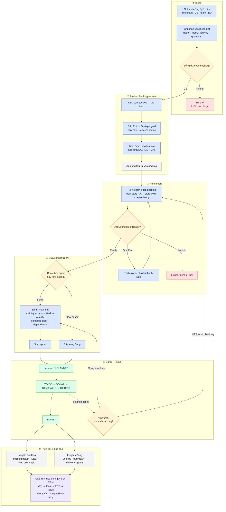

# Product Backlog cho CRM — prototype

Prototype khu **Product Backlog** cho phần *Quản lý công việc* trong CRM nội bộ của team (workspace.mida-app.io, nền Twenty CRM). Mục tiêu: tách rõ **Ideas → Backlog item → Issue trên Bảng**, có hệ thống ưu tiên, refinement và sprint planning, để team product làm việc và báo cáo ngay trên CRM.

> **Trạng thái:** prototype để demo nội bộ. Giao diện dựng lại theo CRM hiện tại, dữ liệu lưu trong trình duyệt. Phần này sẽ được tích hợp và chỉnh sửa tiếp khi đưa vào CRM thật; phân quyền, comment, thông báo, tích hợp… thuộc phạm vi CRM nên chưa làm ở đây.

---

## 1. Vì sao cần phần này

Các vấn đề team product đang gặp với CRM hiện tại:

| # | Vấn đề hiện tại | Hệ quả |
|---|---|---|
| 1 | **Ideas, item backlog và issue đang chạy đều nằm chung một hệ thống board.** Có tab Backlog riêng nhưng hạn chế: không phân chia rõ ràng, và mọi thứ dùng chung một format thông tin với issue trên board. | Không phân biệt được việc *đang cân nhắc* với việc *đang làm*; item backlog không có chỗ ghi những gì PM cần (giá trị, điểm ưu tiên, mức sẵn sàng…). |
| 2 | **CRM đã có Sprint nhưng thiếu hệ thống kiểm soát sprint**: không có planning, không có cách đưa item từ backlog vào sprint, không đo được velocity / burndown. | Không biết sprint có đang nhận quá sức không, không có dữ liệu để cải thiện. |
| 3 | **Team chủ yếu chưa chạy sprint** — item backlog đi thẳng vào board theo kiểu flow-based. Khi cần chạy sprint chuẩn thì không có công cụ, và không chạy song song được sprint với flow tự do. | Muốn chuyển cách làm việc thì phải đổi công cụ hoặc làm tay. |
| 4 | **Báo cáo cấp trên chưa clear.** Board trộn mọi trạng thái nên khi tổng hợp phải tạo Google Sheet riêng, viết tay lại các item, và thêm một sheet khác cho issue. | Mất thời gian, dễ lệch số liệu; họp và trao đổi diễn ra ngoài CRM. |
| 5 | **Cấp trên chỉ thấy việc khi đã là issue xong xuôi**, sẵn sàng chuyển dev. | Không theo dõi được quá trình từ ý tưởng → mục tiêu → backlog → đánh giá khi còn là item, nên khó góp ý sớm. |

## 2. Prototype giải quyết thế nào

| Vấn đề | Giải pháp trong prototype |
|---|---|
| 1 — Trộn lẫn, chung format | Tách 3 loại đối tượng: **Idea** (tab Ideas) → **Item** (Product Backlog, có đủ cấu hình PM) → **Issue** (Bảng, chỉ thông tin thực thi). Product Backlog là mục riêng trên sidebar, tách khỏi Bảng. |
| 2 — Thiếu kiểm soát sprint | **Sprint Planning**: sprint goal, *committed vs velocity*, cảnh báo item chưa đạt Definition of Ready hoặc còn dependency, Start / Hoàn thành sprint kèm carry-over. Bảng có **Insights**: velocity, burndown, delivery signals. |
| 3 — Chỉ flow-based | Hai đường sang Bảng: **Start sprint** (đẩy cả sprint) hoặc **Đẩy sang Bảng** từng item (flow-based). Cả hai cùng vào cột **PLANNED** trên cùng một Kanban → chạy song song được. |
| 4 — Báo cáo bằng sheet tay | **Insights Backlog**: backlog health, DEEP, phân bổ theo goal / epic / template; mỗi cảnh báo mở thẳng danh sách item đã lọc. Họp và trao đổi trực tiếp trên CRM. |
| 5 — Cấp trên thấy muộn | Mỗi item gắn **Epic + Strategic goal**, có *why now*, *success metric*, điểm ưu tiên và trạng thái DoR — cấp trên xem được từ lúc còn là Idea / Item. |

## 3. Workflow chính của team product

**Idea → Item → (ưu tiên + refinement) → Issue**

1. Ý tưởng / yêu cầu được ghi vào **Ideas**; PM chọn đưa vào backlog hoặc từ chối.
2. Ý tưởng thành **Item** trong Product Backlog, gắn epic và strategic goal.
3. Item được **chấm điểm theo template ưu tiên** đang chọn (mặc định *SAE ICE × CAF* của team) và sắp thứ tự.
4. Item ở top backlog được **refinement**: user story, acceptance criteria, story point, dependency — cho tới khi đạt **Definition of Ready**.
5. Khi sẵn sàng, item **chuyển sang Bảng** thành Issue — theo sprint hoặc flow-based.
6. Issue chạy trên Kanban tới DONE; số liệu lên **Insights** cho cả team và cấp trên.

### Use case flow — Product member



Chú thích màu: 🟦 việc PM làm · 🟨 điểm quyết định · 🟩 issue trên Bảng · ⬜ hệ thống tự tính · 🟪 cấp trên theo dõi · 🟥 kết thúc nhánh.

## 4. Tính năng trong prototype

**Sidebar → Quản lý công việc**: `Bảng` · `Product Backlog` (mục mới).

### Product Backlog
| Tab | Chức năng |
|---|---|
| **Danh sách** | Backlog theo rank, nhóm theo sprint planned; kéo thả đổi thứ tự / đưa vào sprint; dòng hiện epic, DoR, story point, dependency. Chế độ **List · Story map · Refinement**. Filter theo người được giao, ưu tiên, loại, epic. |
| **Ưu tiên** | Chấm điểm theo template đang chọn, biểu đồ theo template, "Áp dụng thứ tự vào backlog". 9 template: SAE ICE × CAF (team), ICE, RICE, WSJF, MoSCoW, Risk/Value, Value/Effort, Kano, 20/20. |
| **Sprint Planning** | Tạo / xoá sprint, sprint goal template, committed vs velocity, cảnh báo DoR / dependency, Start sprint, hoàn thành sprint + carry-over. |
| **Ideas** | List ý tưởng (nguồn, người yêu cầu, quote, số lần yêu cầu) → đưa vào backlog hoặc từ chối. |
| **Insights** | Backlog health + DEEP, cảnh báo có link mở danh sách đã lọc, phân bổ theo epic / goal / bug severity / template, "Review lần cuối". |
| **Thiết lập** | Strategic goals, Definition of Ready, Prioritization template (+ cấu hình riêng từng template). |

### Bảng
| Tab | Chức năng |
|---|---|
| **Kanban** | Chỉ chứa issue. Cột: PLANNED · TO DO · DOING · REVIEWING · RETEST · DONE. Kéo thả đổi trạng thái. |
| **Insights** | Tiến độ sprint, velocity, burndown, issue theo trạng thái, delivery signals. |

## 5. Thuật ngữ

| Thuật ngữ | Nghĩa |
|---|---|
| **Idea** | Ý tưởng / yêu cầu thô, chưa cam kết. |
| **Item** | Phần tử trong Product Backlog — đang được đánh giá, ưu tiên, refine. |
| **Issue** | Item đã chuyển sang Bảng để thực thi. |
| **Epic** | Nhóm item cùng một mảng tính năng. |
| **Strategic goal** | Mục tiêu chiến lược (roadmap theme / OKR) mà epic và item phục vụ. |
| **Template ưu tiên** | Phương pháp chấm điểm (ICE × CAF, RICE, WSJF…). |
| **Definition of Ready (DoR)** | Tiêu chí item phải đạt trước khi vào sprint / sang Bảng. |
| **Velocity** | Trung bình story point hoàn thành ở 3 sprint gần nhất. |

## 6. Chạy prototype

Yêu cầu: Node.js 20+.

```bash
cd app
npm install
npm run dev      # mở http://localhost:5173
npm test         # unit test công thức ưu tiên
npm run build    # build production
```

- Dữ liệu lưu trong **localStorage** của trình duyệt. Muốn quay về dữ liệu ban đầu: *Product Backlog → Thiết lập → Reset dữ liệu demo*.
- Dữ liệu ban đầu gồm issue thật của project **MIDA Fraud Feature** (snapshot ngày 2026-10-24) cộng **dữ liệu demo** (điểm, story point, sprint, ideas, issue có tiền tố `[Demo]`) để có nội dung trình bày.

## 7. Cấu trúc thư mục

```
app/src/
  data/          types, seed (dữ liệu ban đầu), meta (status, loại, priority)
  lib/
    prioritization/   9 template ưu tiên + unit test
    readiness.ts      Definition of Ready, DEEP
    metrics.ts        velocity, burndown, stale
  store/         zustand store (lưu localStorage), filter, hooks dùng chung
  components/    shell (sidebar, toolbar, filter), panel chi tiết item, UI primitives, chart
  views/
    backlog/     Danh sách, Refinement, Ưu tiên, Sprint Planning, Ideas, Insights, Thiết lập
    board/       Kanban, Insights của Bảng
PLAN.md          kế hoạch + nhật ký thay đổi theo phiên bản
```

## 8. Phạm vi & giới hạn

- Chỉ một project (MIDA Fraud Feature); project switcher và các mục sidebar khác là giao diện tham khảo.
- Không có đăng nhập / phân quyền / comment / thông báo / tích hợp — để CRM thật đảm nhận khi tích hợp.
- Tên đối thủ trong template SAE ICE × CAF đang là placeholder.

## 9. Lịch sử phiên bản

| Phiên bản | Nội dung chính |
|---|---|
| **V1.1** | Dựng shell CRM, Kanban, Danh sách; 9 template ưu tiên; grooming, sprint planning, insights, review, ideas, thiết lập. |
| **V1.2** | Tách item / issue, cột PLANNED, Product Backlog thành mục riêng, Insights bên Bảng, chọn template ở Thiết lập. |
| **V1.3** | Làm gọn theo workflow thật của team: Refinement thay grooming session, bỏ planning poker / review / retro / buckets / capacity…; Backlog health có link lọc; Filter thật; epic trên dòng; xoá sprint; card Prioritization template; thuật ngữ item / issue. |
| **V1.3.5** | Bỏ hẳn Definition of Done. |

Chi tiết từng thay đổi: xem [`PLAN.md`](PLAN.md).
